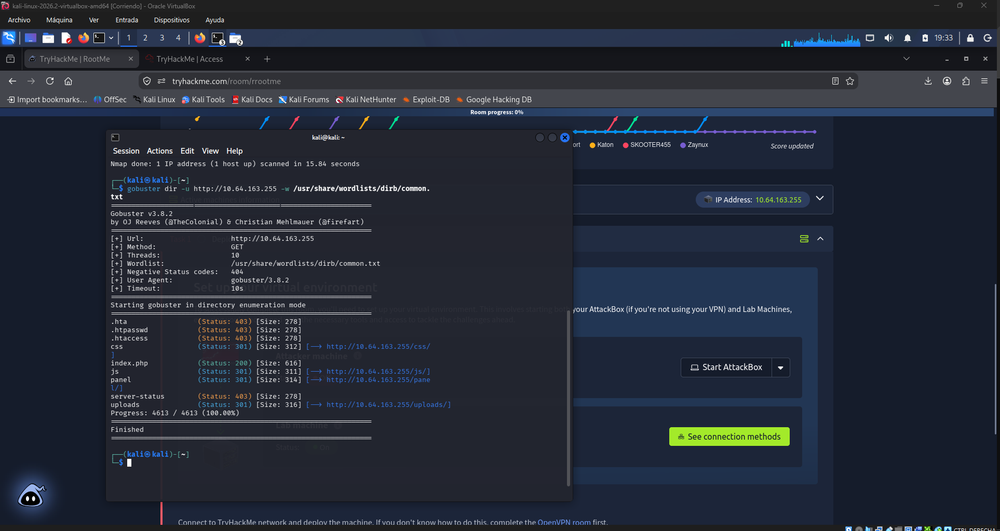

# Coso2

## 1. Objetivo y Descripción
El objetivo de este laboratorio es aplicar técnicas de reconocimiento, explotación de vulnerabilidades web y escalada de privilegios en un entorno controlado para comprometer un servidor Linux y obtener acceso de superusuario (root).

## 2. Herramientas Utilizadas
- **Nmap**: Escaneo de puertos y enumeración de servicios.
- **Gobuster**: Fuerza bruta para el descubrimiento de directorios y rutas web.
- **Netcat (nc)**: Interceptación de conexiones para establecer una *Reverse Shell*.
- **GTFOBins**: Recurso para evadir restricciones de seguridad locales aprovechando binarios legítimos.

## 3. Metodología y Etapas

### 3.1. Reconocimiento
Se inició el análisis con un escaneo de puertos utilizando Nmap para identificar los servicios expuestos en la máquina objetivo.

**Comando ejecutado:**
`nmap -sC -sV <IP_OBJETIVO>`

**Resultados de Nmap:**
- **Puerto 22/tcp**: Abierto (Servicio: SSH, Versión: OpenSSH 7.6p1 Ubuntu 4ubuntu0.3)
- **Puerto 80/tcp**: Abierto (Servicio: HTTP, Versión: Apache httpd 2.4.29)

Al verificar que el puerto 80 alojaba un servidor web, se procedió a realizar fuerza bruta de directorios utilizando Gobuster:
`gobuster dir -u http://<IP_OBJETIVO> -w /usr/share/wordlists/dirb/common.txt`

*Hallazgos*: Se descubrieron rutas administrativas ocultas, incluyendo `/p***l` (formulario de subida) y `/u*****s` (directorio de almacenamiento de archivos subidos).
> **Evidencia:** 

### 3.2. Explotación (Obtención de Shell)
En el directorio oculto de subida de archivos, se detectó una vulnerabilidad de **Unrestricted File Upload**. El servidor aplicaba un filtro básico que bloqueaba archivos con la extensión estándar `.php`. 

Para evadir esta restricción (Bypass), se modificó la extensión del *payload* malicioso (Reverse Shell) a una variante alternativa permitida por el servidor (`.p***`). Una vez subido el archivo, se ejecutó navegando a su ruta en el servidor, lo que permitió establecer una conexión inversa hacia la máquina atacante mediante Netcat.

- **Usuario comprometido:** `www-data`
- **Flag de usuario (user.txt):** `THM{******************************}`
> **Evidencia:** 

### 3.3. Escalada de Privilegios
Una vez dentro del sistema con privilegios limitados, se procedió a enumerar los binarios con el bit **SUID** activado, buscando vectores de escalada de privilegios.

**Comando ejecutado:**
`find / -type f -user root -perm -4000 2>/dev/null`

Se identificó que el binario `/usr/bin/p****n` poseía permisos SUID anómalos. Consultando la documentación de GTFOBins, se construyó un comando de una sola línea (*one-liner*) que aprovechó este binario para invocar una consola interactiva (`/bin/sh -p`), manteniendo los privilegios de propietario (root).

- **Usuario comprometido:** `root`
- **Flag de root (root.txt):** `THM{******************************}`
> **Evidencia:** 

---

## 4. Vulnerabilidades Encontradas y su Impacto

1. **Unrestricted File Upload (Bypass de validación de extensiones)**
   - **Impacto:** Crítico. Permite a un atacante no autenticado subir y ejecutar código arbitrario en el servidor (RCE - Remote Code Execution), logrando el compromiso inicial del sistema. La validación en el lado del servidor era deficiente al basarse únicamente en una lista negra incompleta.

2. **Configuración Insegura de Permisos (Bit SUID en binario del sistema)**
   - **Impacto:** Crítico. Permite a cualquier usuario local, sin importar sus privilegios, ejecutar comandos en nombre del superusuario. Esto rompe la segmentación de privilegios del sistema operativo y deriva en un compromiso total del host.

## 5. Propuesta de Remediaciones

- **Para la vulnerabilidad web (Subida de archivos):**
  1. Implementar listas blancas (*Whitelisting*) estrictas, permitiendo únicamente extensiones seguras (ej. `.png`, `.jpg`, `.pdf`).
  2. Validar el contenido real del archivo verificando su *Magic Number* (cabecera del archivo), no solo su extensión.
  3. Deshabilitar la ejecución de scripts del lado del servidor (como PHP o Python) dentro del directorio de almacenamiento (`/u*****s`).

- **Para la escalada de privilegios (SUID):**
  1. Auditar regularmente los permisos del sistema.
  2. Retirar el bit SUID del binario afectado si no es estrictamente necesario para el funcionamiento del sistema (`chmod -s /usr/bin/p****n`).
  3. Aplicar el principio de mínimo privilegio en todos los servicios y herramientas del servidor.

## 6. Conclusiones y Aprendizajes
La resolución de este CTF demuestra que las restricciones de seguridad basadas en listas negras simples son ineficaces contra técnicas de *bypass* de extensiones. Además, resalta la importancia de una correcta administración de permisos en sistemas Linux; un solo binario mal configurado con permisos SUID es suficiente para comprometer toda la infraestructura. Se fortalecieron competencias en enumeración web, evasión de filtros y uso de recursos documentales (GTFOBins) para la escalada de privilegios.
